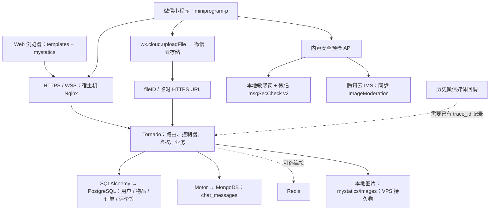

# 翠友雅集

翠友雅集是一个面向社区闲置物品交流与交易的平台，已有 **Web 网页端和微信小程序端**。两端共用 Python / Tornado 后端，提供用户登录、物品发布、聊天、订单和评价等能力。

本文以当前仓库代码为依据；不把参赛演示图片、宣传材料或历史部署教程视为已实现功能。部署文件描述的是配置方案，不代表已经检查过线上服务。本次文档更新不执行 VPS 部署或小程序发布。

## 1. 已实现能力与边界

| 模块 | 当前实现 | 限制 / 尚未完成 |
| --- | --- | --- |
| 双端 | Web 模板页面；原生 WXML / WXSS / JavaScript 小程序 | 小程序源码已经存在，不需要从 HTML 转换 |
| 用户 | 密码登录、手机号短信登录、Web 微信 OAuth、小程序微信登录、资料与手机号绑定 | 外部服务需要单独配置；短信、邮件和微信能力不因源码存在就自动可用 |
| 物品 | 发布、编辑、多图、标签、搜索、库存、上下架、收藏、卖家主页和黑名单 | 服务端发布接口没有统一强制内容审核入口，不能依赖客户端预检防绕过 |
| 聊天 | WebSocket 聊天、MongoDB 消息历史、未读数、已读标记、清理会话 | 微信订阅通知需要用户授权及有效模板配置，不是通用离线推送保证 |
| 订单 / 评价 | 创建、发货、确认、取消、删除及买卖双方查询；商品评价与评分 | 没有可据以宣称上线支付、担保或资金结算的实现；订单不等于支付 |
| 自动确认 | 后端每 15 分钟检查，已发货超过 24 小时自动完成 | 依赖应用进程持续运行，不是独立持久任务队列 |
| 管理端 | 管理员登录、用户、商品、订单管理 | 生产权限与安全配置仍需独立核验 |
| 内容安全 | 本地敏感词、微信 msgSecCheck v2、腾讯云 IMS 同步图片检测；保留历史媒体回调接口 | 存在跳过检测和旧异步状态不兼容，详见下文；不是完整审核闭环 |

规划或待补齐的能力包括：统一服务端强制审核、可追踪的审核重试与人工复核、完整生产安全加固。AI 问答、智能鉴定、估价和推荐不能作为当前已实现能力介绍；`app.py` 中 AI 查询处理器的导入仍为注释。本次不实现新的 AI 功能。

## 2. 技术栈与架构

- Python 3.11；Tornado **6.4.2**。
- SQLAlchemy **2.0.28**；当前关系型数据方案为 **PostgreSQL**（VPS 配置使用 15）。
- Motor **3.6.0** / PyMongo **4.9.2**；MongoDB 保存在线聊天消息。
- Redis 客户端 **5.0.3**；应用启动时连接失败可继续运行，不是所有业务的强制依赖。
- Pillow 生成本地缩略图、中等尺寸图；微信云存储支持 `cloud://` 文件标识。
- VPS 配置使用 Docker Compose、宿主机 Nginx、MongoDB Atlas。



### 数据库选择和初始化

`base/base.py` **实际读取 `DATABASE_URL`**。仅有 `NEON_DATABASE_URL`、`PGHOST` 等变量并不会自动使 ORM 连接 PostgreSQL；使用托管 PostgreSQL 时，需要通过运行环境安全提供 `DATABASE_URL`。

历史兼容分支和旧驱动仍存在，但不应按旧关系库教程安装或初始化当前系统。本项目约定不修改 `base/` 和 `config.ini`。

`app.py` 优先读取 `MONGODB_URI`；URI 含数据库名时使用该名称，否则使用 `chat_db`。未提供 URI 时，读取 `MONGODB_HOST`、`MONGODB_PORT`、`MONGODB_DATABASE`，并回退到本地配置。启动时为 `chat_messages` 创建组合索引。

`python init_db.py` 调用 `Base.metadata.create_all()`，用于创建缺失表，**不会迁移已有表结构**。关系表主要采用 `xu_` 前缀；`models/image_verification.py` 的审核记录模型属于额外模块，不能假定初始化脚本覆盖所有后加模型。已有库升级需逐项审查 `migrations/`，不要一次执行所有历史脚本。

### 图片存储的真实路径

1. Web 与后端文件上传使用 `mystatics/images/`，通过 `/images/…` 或 `/static/images/…` 访问。本地物品上传会生成缩略图和中等尺寸图。
2. 小程序 `utils/cloudStorage.js` 实际调用微信云上传 API，上传后将 fileID 交给 `/api/miniprogram/product/create` 或 `/product/add-cloud-images` 保存引用；不能把“保存引用”当成服务端重新上传或审核。
3. 后端会检测是否在微信云托管环境；物品和头像上传都有本地回退分支。**但 `utils/wechat_cloud_storage.py` 的 `upload_file_to_cloud()` 当前只生成并返回 fileID，没有执行真实对象上传**。因此不能宣称该后端云上传路径已完整可用，也不能保证伪成功会触发回退。
4. `cloud://` 不是浏览器可直接访问的普通 URL。代码包含临时 HTTPS URL 转换、缓存与批量处理；转换依赖微信配置、环境及授权，失败可能保留原 fileID，不能保证 Web 显示成功。
5. VPS Compose 的 `secondhand_app_uploads` 卷保存本地图片；切换容器不会自动把本地图片迁移到云端。数据库备份和图片备份需要分别处理。

## 3. 内容安全链路与失败策略

主要实现：[服务端](../controllers/content_security_controller.py)、[小程序预检工具](../miniprogram-p/utils/contentSecurity.js)、[本地敏感词](../utils/keyword_filter.py)。

### 文本

- 小程序在发布、编辑、资料等调用点先执行文本预检；接口为 `POST /api/miniprogram/security/text-check`。
- 有可用 openid 时，服务端检测函数先跑本地敏感词，再调用微信 `msgSecCheck` v2；远端请求截取前 2500 字。`suggest != pass` 视为不安全。
- 接口拿不到 openid 时会直接跳过，**不会进入本地词库检测函数**。
- 微信凭据缺失、获取 token 失败、用户不活跃或接口异常等通常返回 `safe: true, skipped: true`；小程序请求失败也默认跳过。这是故障放行，不是审核通过。

### 图片：目前是同步检测，不是异步复检

- 发布 / 编辑页先压缩图片，再调用历史名 `checkImageWithBase64()`。它实际上用 `wx.uploadFile` 以 multipart 上传 `media` 文件，不在客户端读取文件转 Base64；服务端转 Base64 后调用腾讯云 IMS。
- 服务端也兼容 JSON 的 `image_base64` 或公网 `media_url`。IMS 返回 `Pass` 才通过；`Block` / `Review` 都返回不安全。
- 腾讯云凭据缺失返回 `safe: true, skipped: true`；SDK 调用异常返回 `safe: false, skipped: false`。外层接口的 `success: true` 只代表返回了检测响应，**不能当成安全结论**。
- 文件预检客户端遇到网络、非 200 或解析异常会返回 `safe: true, skipped: true`。发布页只拦截 `!safe && !skipped`，技术故障可能放行；普通 URL 检测工具的异常策略不同，返回不安全。
- `cloud://` 直接提交给媒体检测 API 会跳过；相对 `/images/` 检测分支按 `static/images` 查找，和主要上传目录不同，找不到文件时也会跳过。音频当前不支持，返回跳过。
- `check_media_security_async()` 名称和小程序部分注释是历史遗留，内部已同步调用 IMS，**不产生微信异步审核 trace_id**。不能据旧注释宣称“上传后一定异步复检兜底”。
- 商品创建 / 追加图片保存路径没有统一重新检测。头像上传仍按旧逻辑等待 trace_id：有 openid 但无 trace_id 时可能一直 `pending`，无 openid 则直接 `approved`；没有完整消费同步 IMS 结果。
- `/wechat/callback`、`/api/miniprogram/security/media-callback` 和状态查询保留历史验证记录处理；只有已有可匹配记录和有效回调时才能更新状态，不是新 IMS 请求的自动后续步骤。测试回调属于受保护的调试入口，不应当作公开生产接口。

## 4. 当前目录

```text
.
├── app.py                       # Tornado 路由及启动、Mongo / Redis 连接
├── init_db.py                   # 创建缺失的 ORM 表
├── requirements.txt
├── config.ini                   # 历史本地配置（不修改，不放入真实凭据）
├── base/                        # ORM 基础连接（不修改）
├── controllers/                 # Web、小程序、聊天、订单和安全接口
├── models/                      # SQLAlchemy 模型
├── templates/                   # Web 模板和管理员页面
├── mystatics/                   # CSS、JS、默认资源和本地上传图
├── static/images/               # 另有历史静态资源目录，不等同主上传目录
├── miniprogram-p/
│   ├── app.js / app.json / app.wxss
│   ├── pages/                   # index、product、chat、order、profile 等
│   ├── utils/                   # API、环境配置、云存储、审核、订阅消息
│   └── images/
├── utils/                       # 图片处理、敏感词、短信、微信存储和通知
├── config/sensitive_keywords.json
├── migrations/                  # 历史迁移脚本，执行前审查
├── deploy/                      # VPS Compose、Nginx、配置模板及运维脚本
├── Dockerfile.prod
├── .github/workflows/deploy.yml  # 注意：含推送后部署行为
├── scripts/                     # 管理及环境辅助脚本
└── docs/README.md               # 本文
```

## 5. 开发启动

环境要求：Python 3.11、可连接的 PostgreSQL 和 MongoDB；Redis 可选。微信、短信、邮件服务按使用功能配置。

```bash
git clone https://github.com/sjx1943/XianyuMarketplace.git
cd XianyuMarketplace
pip install -r requirements.txt
```

在运行环境的安全配置中提供变量，**不要把真实连接串写进文档、仓库或聊天**。以下只是格式，不可直接作为有效配置：

```dotenv
DATABASE_URL=postgresql://APP_USER:REPLACE_ME@DB_HOST:5432/APP_DB
MONGODB_URI=mongodb://DB_HOST:27017/chat_db
REDIS_HOST=127.0.0.1
REDIS_PORT=6379
```

`DATABASE_URL` 是必需的当前数据库选择项。小程序需 `WX_MINIPROGRAM_APP_ID`、`WX_MINIPROGRAM_APP_SECRET`；图片检测需 `TENCENT_SECRET_ID`、`TENCENT_SECRET_KEY`；历史微信回调需 `WECHAT_CALLBACK_TOKEN`。短信使用 `ALIYUN_*` 配置；Web OAuth 使用 `WECHAT_APP_ID`、`WECHAT_APP_SECRET`、`WECHAT_REDIRECT_URI`。仅配置要使用的功能；未配置审核服务时须了解上述放行策略。

启动前还必须安全提供 `SESSION_SECRET`（足够长的随机签名密钥），不再使用内置 cookie 签名值。切换此密钥会使已有登录 cookie 失效。邮件重置需配置 `SMTP_USER`、`SMTP_PASSWORD` 等；发布快照已移除内置邮件账号和口令。

```bash
python init_db.py
python app.py --port=5000
```

本地打开 `http://localhost:5000/`；`GET /health` 应返回 `{"status":"ok"}`。此健康接口**不探测数据库、云存储和审核服务**，不能据此认定所有功能正常。开发预览通过运行环境提供的代理地址访问。

注意：

- GitHub 脱敏快照包含启动必需的 `controllers/auth_controller.py`，其内置邮件凭据已清除；短信新用户使用随机初始密码。原开发工作区的私有副本仍被本地忽略规则保护，不应直接强制添加。
- 启动输出已改为只报告数据库连接串是否配置，不输出连接串本身。但其他日志和 SQL 调试输出仍需脱敏，不要公开整份日志。当前 `app.py` 仍设置 `debug=True`，没有读取 `DEBUG=False` 进行覆盖，生产使用前应另行加固。
- 不要将本地库、导出数据、用户图片、个人授权书或生成的参赛材料提交到 Git。

## 6. 微信小程序开发与环境切换

1. 在微信开发者工具导入 **`miniprogram-p/`**，按自己的账号设置 AppID 和本地项目配置；当前目录没有可直接复用的 `project.config.json`。
2. 编辑 [utils/config.js](../miniprogram-p/utils/config.js)：`isDev = true` 选 `api.development`，`false` 选 `api.production`。**不是自动识别开发版 / 体验版 / 正式版**。
3. 开发环境把 `development.host` 改为当前可访问的 HTTPS 后端代理地址；仓库中的开发地址可能已失效。生产 `production.host` 应与实际部署一致，不能只修改注释。
4. `apiBase` 当前为空；接口调用自身包含 `/api/miniprogram/...`，不要额外重复添加 `/api`。`wsBase` 为 `/ws`，HTTP(S) 自动转换为 WS(S)，聊天路由还需要 `/chat_room/{user_id}`。
5. `getImageUrl()` 对 `/images/...` 或文件名拼接所选 host；`cloud://` 需要微信云 API / 临时 URL 转换，不在该函数内完成。
6. 同时检查 [app.js](../miniprogram-p/app.js) 的 `CLOUD_ENV_ID` 和 `globalData.baseUrl`：后者启动时仍取生产 host，未随 `isDev` 一起切换。不能假定修改一个开关即可覆盖所有调用。
7. 使用云上传需配置可访问的微信云环境和权限；不启用云上传时检查后端文件上传及持久化。服务器 request / uploadFile / downloadFile / socket 合法域名、TLS 和端口要求需按微信平台当前规则核对；开发者工具关闭校验不代表真机可用。

本步骤只说明开发配置，不执行上传审核或小程序发布。

## 7. VPS 部署配置说明（不在本任务执行）

以 [deploy/docker-compose-vps.yml](../deploy/docker-compose-vps.yml)、[Dockerfile.prod](../Dockerfile.prod) 和 [Nginx 配置](../deploy/nginx_secondhand_8543.conf) 为依据，而非根目录旧版教程。

| 服务 | 当前映射 / 入口 |
| --- | --- |
| Tornado | 容器 `8000` → 宿主机 `127.0.0.1:8100` |
| PostgreSQL 15 | 容器 `5432` → 宿主机 `127.0.0.1:5433` |
| Redis 7 | 容器 `6379` → 宿主机 `127.0.0.1:6380` |
| MongoDB | Compose 不启动 MongoDB；通过 `MONGODB_URI` 连接 Atlas |
| Nginx | 宿主机终止 TLS；`8543` 反代完整应用；`443` 直通两个媒体回调路径，其余重定向至 `8543` |

下面命令只供取得部署授权后在 VPS 使用：

```bash
# 在仓库根目录；环境文件必须位于 deploy/ 下
cp deploy/.env.prod.template deploy/.env.prod
chmod 600 deploy/.env.prod
# 通过安全方式填写配置；不要打印包含凭据的 Compose 展开结果
docker compose --env-file deploy/.env.prod -f deploy/docker-compose-vps.yml up -d --build
docker compose --env-file deploy/.env.prod -f deploy/docker-compose-vps.yml ps
curl --fail http://127.0.0.1:8100/health
```

- 模板顶部旧说明与 Compose 的实际相对路径不同，以上使用 `deploy/.env.prod`。Compose 插值也必须传 `--env-file`，仅服务的 `env_file` 不代替插值输入。
- 配置真实 `PGPASSWORD`、`MONGODB_URI` 及需要的服务变量；密码含 URL 特殊字符时注意连接串编码。模板未列全腾讯云 IMS 和回调变量，应补充到私有环境文件而不是提交模板中的真实值。
- PostgreSQL 初始化挂载 `deploy/init-db.sql`，只在空数据卷首次运行；该文件创建的无前缀表与应用主要 ORM 表不同，不能替代 `python init_db.py` 或正式迁移。应用容器启动命令还会执行 `init_db.py`。
- 图片与日志分别持久化到命名卷，数据库有独立卷；不要以删除数据卷作为升级步骤。
- Nginx 配置内的域名及证书路径是现有配置值，迁移时应改为自己的域名并先准备证书。WebSocket 需保留 Upgrade / Connection 头。审核回调走 443 不代表所有小程序请求都已在 443 直通。
- 本仓库 GitHub Actions 含 main / production 推送触发器和 SSH 部署动作，且部分命令仍使用另一套旧 Compose 路径。**仅同步代码时必须确保不会触发 VPS 部署**，不要把该流程视为已经验证的发布方案；其中“测试通过”的输出也不代表实际运行了测试。

## 8. 代表性接口

以 `app.py` 路由和对应处理器的方法为准；下表不是完整 API 规范。

| 方法 | 路径 | 用途 |
| --- | --- | --- |
| GET | `/health` | 进程健康响应 |
| POST | `/login`、`/register` | Web 登录、注册 |
| POST | `/api/send_code`、`/phone_login` | 短信验证码、手机号登录 |
| GET | `/wechat/login`、`/wechat/oauth_callback` | Web 微信 OAuth；不要误用媒体回调 `/wechat/callback` |
| POST | `/api/miniprogram/login` | 小程序登录 |
| GET | `/api/miniprogram/user/info` | 当前小程序用户 |
| GET | `/product_list`、`/api/miniprogram/products` | Web / 小程序物品列表 |
| GET | `/product/detail/{id}`、`/api/miniprogram/product/{id}` | 物品详情 |
| POST | `/product/upload`、`/api/miniprogram/product/upload` | 文件上传及物品发布 |
| POST | `/api/miniprogram/product/create` | 用已上传的云文件引用创建物品 |
| POST | `/api/miniprogram/product/add-cloud-images` | 为已有物品追加云文件引用 |
| POST | `/api/miniprogram/product/update` | 小程序编辑物品 |
| GET / POST | `/orders` | Web 订单列表 / 创建；不是 `/create_order` 创建 POST |
| PUT / DELETE | `/orders/{id}` | Web 更新 / 取消订单 |
| GET | `/api/miniprogram/orders`、`/api/miniprogram/order/{id}` | 小程序订单查询 |
| POST | `/api/miniprogram/order/{id}/ship`、`/api/miniprogram/order/{id}/confirm` | 发货、确认收货 |
| GET | `/api/messages`、`/api/miniprogram/messages` | 消息历史 |
| POST | `/api/send_message` | 发送消息 |
| WebSocket | `/ws/chat_room/{user_id}` | 实时聊天，不是无参数的 `/ws/chat_room` |
| GET | `/api/comments/{product_id}` | 查询物品评价 |
| POST | `/api/comments` | 提交评价，物品 ID 放在请求体 |
| GET | `/api/product/{id}/rating` | 评分统计 |
| POST | `/api/miniprogram/security/text-check`、`/api/miniprogram/security/media-check` | 文本 / 图片预检 |
| POST | `/api/miniprogram/security/verification-status` | 历史 trace_id 审核状态查询 |
| GET / POST | `/api/miniprogram/security/media-callback`、`/wechat/callback` | 微信回调验证 / 通知 |

Web 使用签名 cookie，写请求通常需要 XSRF token；小程序接口多覆盖 XSRF 校验并使用 `Authorization: Bearer ...`。现有小程序鉴权实现不能等同于成熟 JWT 验签系统；权限、令牌不可伪造性和过期策略应在生产前专项检查。

## 9. 排查与代码同步

- 启动缺模块：先核对依赖和被忽略的认证控制器，不要把本地配置文件、私钥或整份环境变量当作问题报告附件。
- PostgreSQL 无表 / 无列：确认应用实际使用的 `DATABASE_URL`；区分建表与迁移，不要对线上库盲跑历史脚本。
- 图片空白：分别核对本地文件持久卷、完整 HTTPS URL、`cloud://` 所属环境与临时 URL 权限；不要仅凭数据库有 fileID 判断对象存在。
- 审核被跳过或头像长期 pending：查看脱敏后的 `skipped` 原因和同步 / 旧异步状态差异，不要承诺后台一定会复检。
- 推送前获取远端 main 最新状态，审查差异及所有待传历史，不提交密钥、个人资料、数据库导出、日志和无关生成文件。远端分叉时保留其历史，不能强推或破坏性重置；认证失败、冲突或分支保护阻止推送时，应明确报告尚未完成。

### 本次代码同步方式

经确认，本次以同步时获取的远端 main 为父提交，发布当前应用的脱敏快照；不合并开发工作区旧历史，不删除本地原件，不修改 `base/` 或 `config.ini`。快照排除环境私密配置、个人授权材料、用户上传图片、参赛生成文件、含固定密码的管理辅助脚本与历史报告。默认静态资源、数据库结构初始化脚本及应用运行源码保留；这些结构脚本不是业务数据导出。

提交使用 `[skip ci]` 跳过 GitHub 的 push 自动运行，确保此次仅同步代码，不部署 VPS。此标记只约束本次提交，不会禁用仓库原有部署流程；后续推送仍需检查自动部署风险。GitHub 上既有历史未重写，历史上已存在的敏感内容应单独处理和轮换，不能把快照脱敏当作历史清除。
